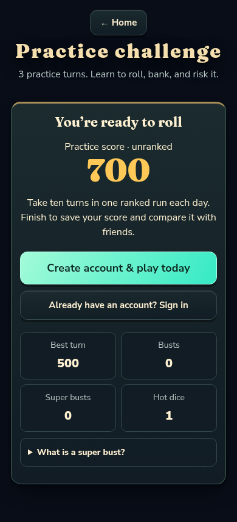
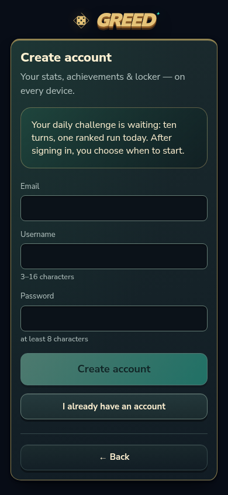
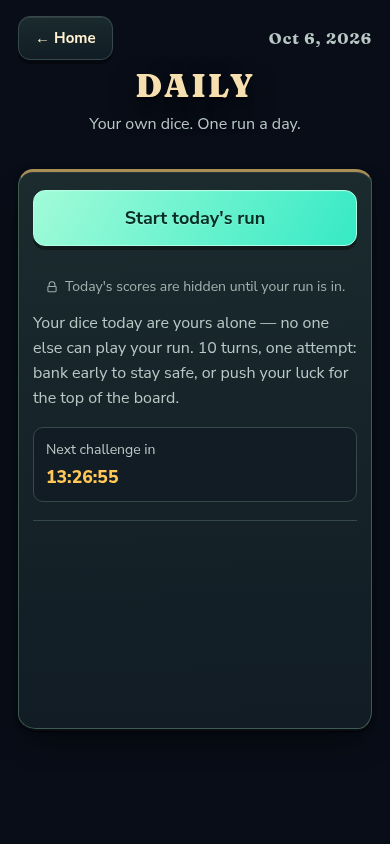
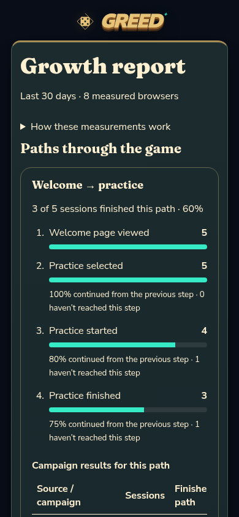

# First-run marketing development review

These onboarding and marketing changes are included in v0.8.3 alongside its goal-progress indicators and larger dice. The screenshots and report counts below come from local browser tests against a disposable PostgreSQL database, not production players.

## What changed

- Finishing the three-turn practice challenge offers **Create account & play today**, plus a sign-in option for returning players. Signed-in players go directly to Daily. The practice score is explicitly unranked, and practice does not change the guest profile or use a challenge attempt.
- Direct Daily entry offers the same account options. The account page explains the destination and that the player still chooses when to start. Completing account creation or signing in never automatically starts a ranked run.
- Practice, Daily, and Weekly update their public play destination in the URL. A refresh during the account step returns to the selected challenge entry; a refresh during a challenge retains that challenge. Home clears the destination. Existing room, campaign, verification, and password-reset parameters are preserved by the URL helper.
- The owner’s growth report now shows ordered steps for welcome → practice, welcome → daily, practice → daily, the daily account step → play, and room invitation → finished game. Each path shows session counts, drop-off, and campaign completion rates with a matching denominator. The report supports empty data, retry, and servers that still provide only the old totals. Retention without an eligible cohort shows “not old enough,” rather than 0%.
- Welcome-page actions send before navigation, and daily account completion sends immediately, so quick page changes can retain the full path. An untagged welcome page is correctly attributed to Welcome / No campaign. Its footer reads the build version automatically.
- New app text and report labels are translated into English, Spanish, and French. The privacy page explains the added account-step actions. Measurements still use fixed labels and independent random browser/session IDs; no account details, scores, or room codes are added.

## Mobile preview

The primary flow uses real practice seed 7 and a synthetic local account. The practice result is computed by the actual game engine.

| Practice finished                                   | Account destination                            | Daily ready                                                      |
| --------------------------------------------------- | ---------------------------------------------- | ---------------------------------------------------------------- |
|  |  |  |

## Validation

- Full repository suite: **841 passed, 3 skipped**, including six real PostgreSQL path tests. The three skips are existing account integration tests gated by `DATABASE_URL`; the new report tests use their own explicitly configured test URL and disposable schema.
- Typecheck, lint, formatting, and production build checked.
- Real Chromium mobile flow: welcome campaign → practice → account creation → Daily → refresh → explicitly start → complete a daily run. Weekly links survive refresh; Home clears the challenge destination. The whole measured flow keeps one session and the approved campaign label.
- Owner report succeeds; anonymous access returns 401 and another account returns 403. Older-server totals, empty data, and error/retry remain readable. The report fits 320px with large text and high contrast in all three languages.
- Additional browser checks and exact receipts are in [entry validation](browser-entry-validation.json) and [report validation](browser-report-validation.json).

The full suite uses its normal guest/mock configuration with `DATABASE_URL` unset. Enabling that variable for every test activates account-backed socket behavior incompatible with existing challenge fixtures; the legacy account test also assumes email verification is required. Database coverage for this change is isolated instead, and signup/sign-in were exercised against the real local server in the browser.

To repeat the database checks, use a disposable local PostgreSQL instance and set `GROWTH_TEST_DATABASE_URL` before running `npx vitest run packages/server/src/growth.integration.test.ts`. Each run creates and drops its own schema. To test collection in development, explicitly set `VITE_GROWTH_RECORDING=true` together with a local `VITE_SERVER_URL`; use a local game server and test database.

## Launch experiment

The [mobile launch kit](../../mobile-marketing.md) has the campaign links, prepared posts, existing vertical gameplay clips, and the 14-day playtest plan. The updated report can compare which pitch produces finished practice and daily runs instead of choosing by page views alone. No posts or recruitment messages were sent as part of this update. Pushing to main triggers the game's normal client and server deployments.

Before recruiting testers, check the flow on physical iPhone and Android devices; these checks used mobile browser emulation.
