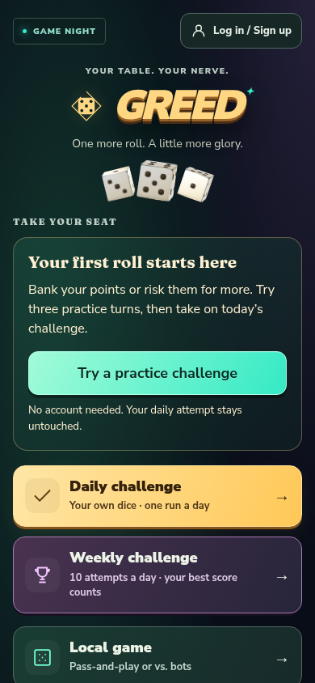
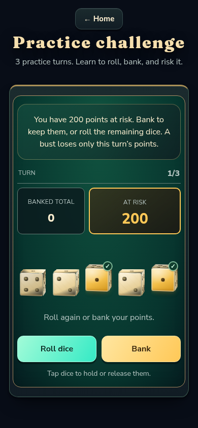
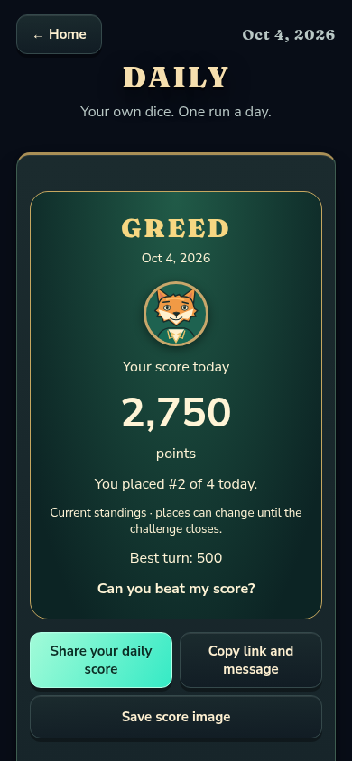
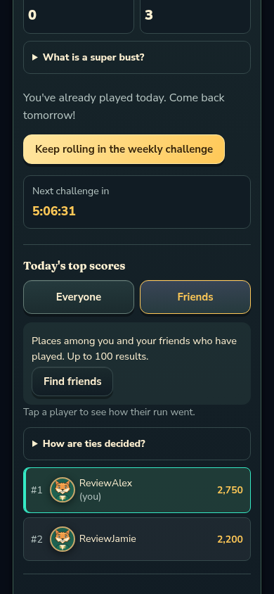

# Mobile marketing pass — review

Greed's next growth step is to help someone try a challenge, return to play, and bring a friend. This first implementation concentrates on daily/weekly challenges and online invitations for mobile players.

This review captures the initial mobile marketing pass included in v0.8.2. See [the release marketing kit](../mobile-marketing.md) for the landing page, production measurement, promotional clips, and launch experiment.

## What to review

- **First visit:** signed-out players who have not completed practice see a prominent invitation to try three practice turns. The existing Learn to play action also opens this challenge. Practice uses the real scoring engine and challenge controls, with explanations for rolling, banking, busts, and hot dice. It runs offline, awards no progression, and consumes no ranked attempts.
- **Daily entry:** signed-in players see a read-only background status on Home: ready, continue a run, or view/share a completed score. Opening Home never starts a challenge. The status refreshes when returning to the tab and at the daily reset.
- **Daily results:** a single branded result card includes the date, equipped portrait, score, best turn, and provisional global place. Share sends a message and challenge link; supporting phones can share a PNG too. Save score image downloads a 1080 × 1080 PNG. Copy remains available, with selectable text if clipboard access is blocked. Cancelling the native sheet is quiet. The weekly challenge is offered next.
- **Friends standings:** daily and weekly boards have Everyone/Friends controls. The server ranks accepted friends and the viewer before limiting to 100 rows, so friends outside the global top 20 still appear. Pending requests and unrelated friendships are excluded. Friend places are explicitly labelled in detail views. Today's daily board remains withheld until the viewer completes their own run. Older servers omit the Friends control safely.
- **Room invitations:** private lobbies offer a native share action and copyable room link. The link opens the correct room after login or signup, survives reloading during login, and remains available while waiting in the lobby. Once the game starts, the existing reconnect token takes over. Leaving the lobby or cancelling entry clears the invitation.
- **Translations/accessibility:** new copy is available in English, Spanish, and French. Controls wrap on narrow phones and support the existing large-text and high-contrast settings.

The current daily gives players independent secret dice. Marketing text therefore asks **“Can you beat my score?”** and does not claim identical dice.

## Screenshots

The screenshots use synthetic local review accounts and an isolated database.

| First visit                                | Practice                                |
| ------------------------------------------ | --------------------------------------- |
|  |  |

| Daily result                            | Friends standings                       |
| --------------------------------------- | --------------------------------------- |
|  |  |

[Example exported score image](score-image.png) · [Private-room invitation](room-phone.png)

## Verification

- Full suite: **819 passed, 3 skipped** across 64 test files. The existing skipped tests require a configured external database.
- Typecheck, ESLint, repository formatting, and production build passed.
- Real browser checks exercised completed daily/weekly boards, score copying, PNG download, simulated native file sharing, sign-in redirects, lobby reloads, and completed Home status.
- Practice completed at 320px and 390px portrait widths and 844px landscape, across the three languages with large text, high contrast, and reduced motion. There were no page errors or horizontal overflow. Practice made no account/score POST requests.
- Browser checks verified blocked-clipboard fallback, quiet native-share cancellation, and a response from an older server without friends standings.
- Isolated embedded PostgreSQL checks exercised real migrations and ranking queries with more than 20 strangers, accepted friends in both directions, pending requests, and unrelated friendships. Circle ranking and the best-turn tiebreak passed for both challenges; the daily completion gate passed.

The native share sheet still needs an actual iPhone/Android check. Automated sharing validation used the browser API with a controlled share handler; it verifies the PNG payload and fallback behavior, not a specific messaging app.

## Production measurement and launch materials

The release adds optional first-party measurements with a Settings control and browser privacy signals. A private owner report includes completions, observed return visits, and invitation conversion. Fixed action/source labels and random browser/session IDs are retained for 30 days; no account names, score values, or dice are sent. Development builds continue to record a bounded local session review log.

See [the marketing kit](../mobile-marketing.md) for collection details, interpretation limits, public destinations, real gameplay clips, ready-to-use copy, and the first 14-day recruitment experiment. Release validation results are recorded there and in the release report.
