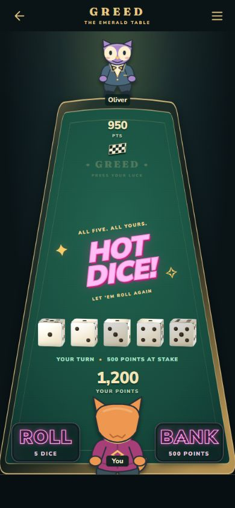
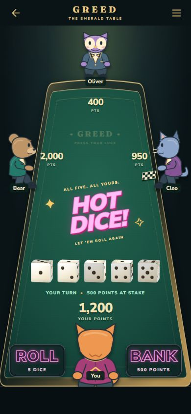
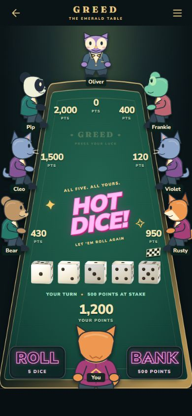
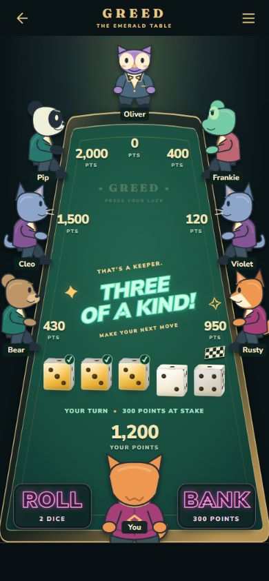
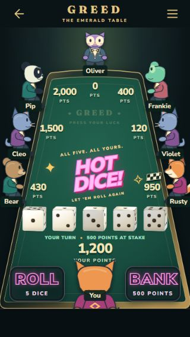
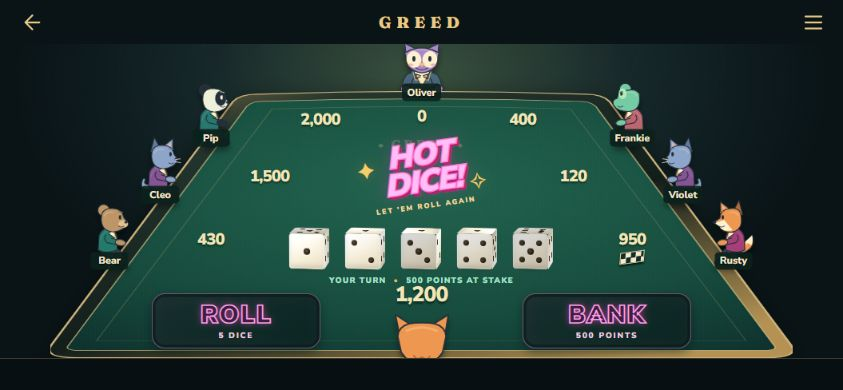
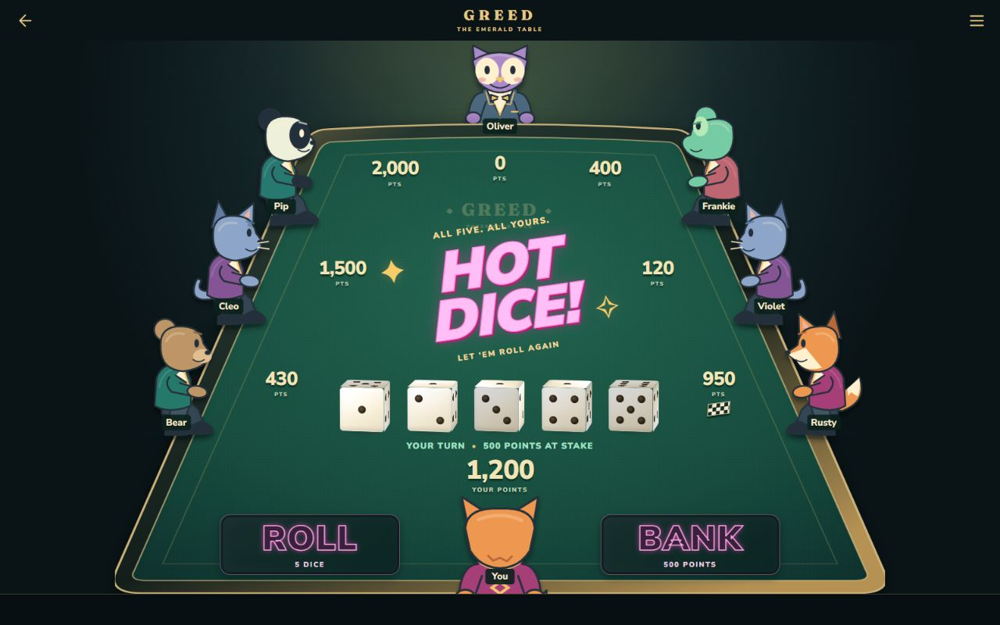

# Table A — composition review

Completed September 11, 2026. Local prototype only; no live deployment, gameplay change, account write or unlock change. Table B has not started.

## Open the prototype

While the local development server is running, open [the review page](http://127.0.0.1:5173/?table-preview). It offers 2/4/8 players, five screen presets, Hot Dice / Three of a Kind / clear table, and held-dice markers. The iframe uses the selected viewport dimensions and scales its presentation to fit the review window. **Open at this window’s full size** removes the review controls.

If the server has stopped, run `npm run dev` from the repository, then open `http://localhost:5173/?table-preview`. This address is local to the computer running the server; it is not the live website or a remotely accessible mobile link.

The preview route and its CSS/art are development-only lazy imports. A production build excludes the prototype. The existing **2525** beta remains as it was. This local design study does not require the beta password and does not modify its saved setting.

Roll and Bank are deliberately disabled display samples. Character/name taps show sample details, and the menu explains the utilities planned for Table C. There is no simulated match or scoring controller. The fixture switches dice, at-stake points and roll count together for the two sample results.

## What to review

- Does the elevated viewpoint feel like sitting behind your character?
- Are the character scale, table depth and casino lighting close to your drawing?
- Does the eight-player phone scene feel readable without being too crowded?
- Are the unboxed lettering and neon button treatment a good direction?
- Is the empty bottom strip an acceptable starting height?

The six existing mascot identities have simple SVG front, side and back body views. These are placeholders, with repeated mascots in the eight-player fixture. Final artwork, complete 2–8 seat geometry, saved customization and match-state integration belong to later chunks.

## Portrait comparison — 390 × 844

### Two players

### Four players

### Eight players

### Three of a Kind and held markers

## Responsive references

### Narrow phone — 320 × 568

### Short landscape — 844 × 390

### Desktop — 1280 × 800

The compact landscape view crops the foreground body heavily to preserve its score and both controls. This is an intentional prototype tradeoff for review. Taller phones show more of that character. Screen dimensions describe desktop browser viewports, not checks on physical iPhone/Android hardware.

## Verification

- Browser layout measurements: 2, 4 and 8 players at 390×844, 360×640, 320×568, 844×390 and 1280×800. Results saved in [layout-audit.json](layout-audit.json).
- All 15 fixtures fit the viewport. Score regions are on-screen; event text bounds, scores, flag and dice corridor do not collide in the recorded checks. Roll/Bank remain visible. Header/action targets and reserved dice cells are at least 44×44 CSS pixels. Character illustrations may intentionally crop at the scene edge.
- Reviewed rendered screenshots, held checks above the cubes, player-count/event controls, menu opening/closing, and navigation back out of the iframe. Browser error log was empty.
- Client TypeScript and repository ESLint passed. Repository formatting passed.
- Full suite: **532 passed, 3 skipped, 41 files passed**. The existing three database tests require a configured Postgres database.
- Production build passed; no TablePrototype, table-preview, tp-screen or prototype title text appeared in the generated bundle. No new dependency or downloaded asset.

These checks verify the fixed composition fixtures. They do not claim to test online play, arbitrary names/scores, 3/5/6/7 seats, timers, localization of this development screen, real gameplay, or full accessibility/device performance. Those remain in the implementation plan.

## Files and next checkpoint

- `packages/client/src/App.tsx`: guarded lazy preview entry.
- `packages/client/src/dev/tablePrototype/TablePrototype.tsx`: review controls, fixed seat fixtures and scene.
- `packages/client/src/dev/tablePrototype/PrototypeCharacter.tsx`: provisional front/side/back illustrations.
- `packages/client/src/dev/tablePrototype/tablePrototype.css`: scoped scene and responsive layouts.
- This folder: review screenshots and measured layout results.

James reported **27%** weekly usage remaining at the start. The final account check reported **16%** remaining; that is an approximately 11-percentage-point account-wide change, not a guaranteed price for future chunks.

Next: collect James’s composition feedback. Make any agreed Table A adjustments, then begin **Table B only when requested**. Extract reusable scene geometry and replaceable character metadata from the approved composition; do not connect gameplay or deploy as part of that geometry chunk.
