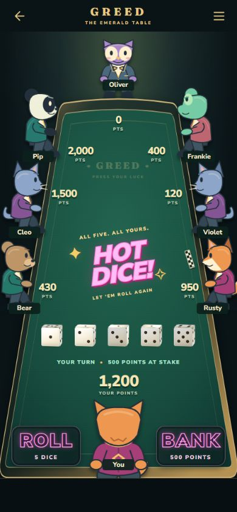
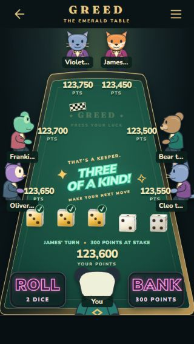
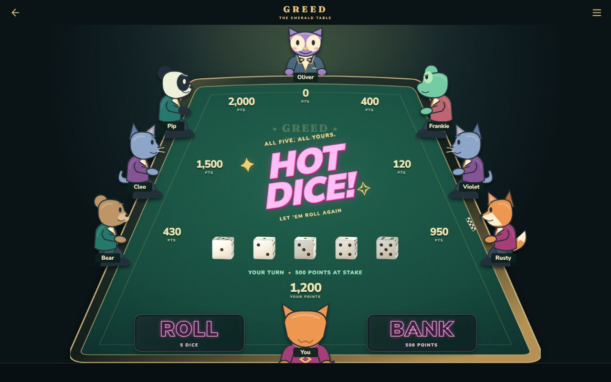

# Table B — reusable scene and character art

Completed September 11, 2026. Table C has not started. This is still a local development preview: no gameplay integration, deployment, account change, unlock change or rule change. The existing 2525 beta and Classic remain unchanged.

[Open the table preview](http://127.0.0.1:5173/?table-preview). Start `npm run dev` if the local server has stopped. This address works on the development computer, not a separate mobile device.

## Changes

- All **2–8 player counts**, including paired far-end seats for 3/5/7 players.
- Pure `tableSceneGeometry` supplies character, name, score and flag rectangles for the measured scene. Classic geometry remains separate.
- `sceneSeatOrder` maps stable player IDs clockwise from the viewing anchor, preserving the original order. Missing anchors fall back to the first player. The authoritative last player is always the final ID of the original order, even when that player is the foreground character.
- `TableScene` composes the surface, characters and labels. Dice, event text, status and action elements are child slots for Table C to connect to existing controllers. No gameplay/timer/account dependency was introduced.
- Six mascots × three views moved to the reusable character layer. Images with different transparent padding can replace individual views through metadata; only artwork mirrors. Unknown IDs and unavailable images use a placeholder while preserving player identity.
- The visible dice are smaller: approximately 25–34px in portrait, 27px in compact landscape and 40px on desktop. Reserved dice cells remain at least 44×44px; actual die interaction is Table C work.
- Checkered markers have their own positions on the felt. Side markers form a strip parallel to the rail; far/foreground markers lie horizontally. Placement no longer follows a score-label offset.
- Scores have bounded regions; long names truncate with full labels/details. The celebration lane and short-landscape score spacing were adjusted to avoid the text conflicts found during stress checks.

The preview offers player count, screen size, viewing seat, long-name/six-digit-score fixtures, spectator labels, held markers and event examples. “Spectator labels” is a presentation fixture, not online spectator integration. Roll and Bank remain disabled samples.

## Updated references

### Eight-player phone — 390 × 844

### Seven-player narrow phone — 320 × 568

Long names, six-digit scores, held dice and a different viewing anchor:

### Desktop — 1280 × 800

## Artwork replacement

[Character art contract and replacement instructions](character-art.md) describe image URLs, normalized bounds, center anchors and fallback behavior.

[Open the image replacement review](http://127.0.0.1:5173/?table-preview&art-review) to see a deliberately padded image, its mirrored form and a missing-image fallback. Browser verification confirmed image/image/placeholder rendering, with the unknown character ID retained. Its deliberate missing image is expected to fail loading.

## Validation

- **35 browser layout fixtures:** every count from 2 through 8 at 320×568, 360×640, 390×844, 844×390 and 1280×800. Used long names and six-digit scores. Recorded checks found no score collisions, flag/score/name collisions, dice/status/event overlap with score regions, viewport overflow, or undersized dice cells.
- **16 perspective checks:** each of the eight viewing anchors at narrow portrait and compact landscape. Foreground ID changed correctly; the flag remained with the original final player. Score/name/dice regions stayed clear of the marker.
- [Recorded browser measurements](layout-audit.json). The record describes fixed fixtures, not a proof for every possible string, viewport or animation frame.
- Client TypeScript, repository ESLint and production build passed. Full suite: **574 passed, 3 skipped, 43 files passed**. The existing skipped tests require configured Postgres. New coverage includes 37 geometry/order tests and 5 art-manifest/placement tests.
- Production output retained the same asset sizes and omitted the table preview. No new dependency or downloaded production artwork. No physical iPhone/Android test was performed.

## Handoff

Primary files:

- `packages/client/src/beta/TableScene.tsx` and `TableSurface.tsx`
- `packages/client/src/beta/tableSceneGeometry.ts` and its tests
- `packages/client/src/beta/tableScene.css`
- `packages/client/src/beta/characters/`
- `packages/client/src/dev/tablePrototype/` for review fixtures only

The prior duplicated dev character component was removed. Scene styling moved out of the preview stylesheet; review-page controls stay in the dev folder. Table A screenshots remain historical references.

The account reported **3% weekly usage remaining near completion**, compared with 16% at the previous checkpoint. This is account-wide usage, not a guaranteed cost for another chunk.

Next authorized chunk should be **Table C**: attach the existing local/solo/pass-and-play controllers, real dice interactions, active-player state, teams, details, drawer and exit/restart behavior. Pass `order` and `perspectiveId` separately; do not derive the flag from display order or rotate pass-and-play on every turn. Preserve die element identity and existing celebration timing. Move development-only English labels through the existing i18n system when these components enter gameplay. Keep the previous beta table available in unvalidated contexts; online integration remains Table E. Do not publish this unfinished scene as a playable match.
