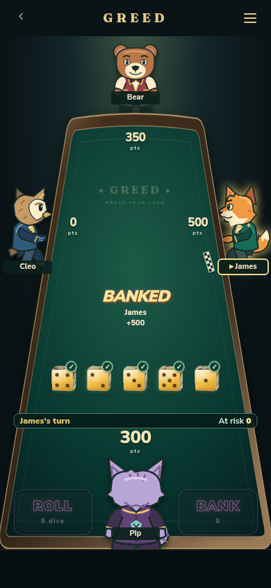
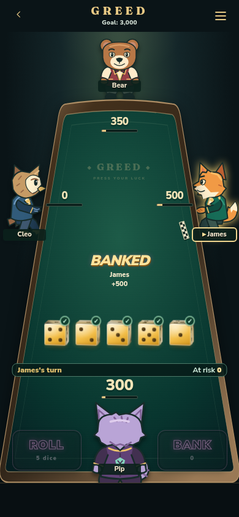
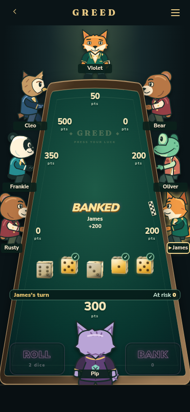
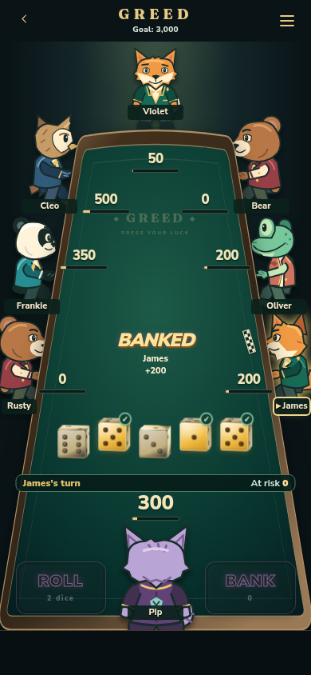
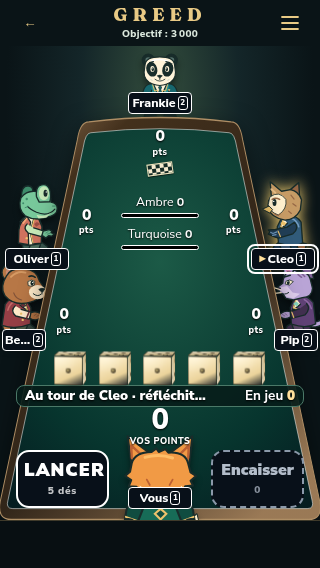
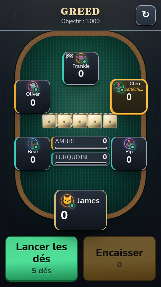

# Goal indicators and larger dice

Every local and online table now shows the configured goal in the header. Each player's banked score has a progress bar; team games show two shared team bars while keeping personal contributions beside each player. Bars fill at the goal and stay full during the final round, even when the actual score goes higher. Opening a player on the illustrated table also shows the points still needed.

The illustrated table's dice are about 15% larger. Classic also uses larger dice where space permits. Narrow phones and short landscape screens size the dice and cards to keep all five dice and the goal indicators visible. Held dice still lift and rolling dice retain their animation. Classic cards keep their bars visible during thinking and offline states.

## Before and after

These are the same seeded local games at 390 × 844, after a round of rolling and banking. The small frame meter is a development overlay.

| Players | Before                                      | After                                     |
| ------- | ------------------------------------------- | ----------------------------------------- |
| Four    |   |   |
| Eight   |  |  |

[Watch the rolling, hold/release, and banking demo](rolling-demo.mp4).

## Additional review screens

French, large text, high contrast, and reduced motion at 320 × 568:

| Illustrated team game                        | Classic team game                          |
| -------------------------------------------- | ------------------------------------------ |
|  |  |

[Classic final-round team scores](classic-team-final.png) show a full bar at 3,450 points against a 3,000-point goal.

## Validation

- Full suite: 830 tests passed; three existing database-dependent tests skipped.
- Type checking, lint, formatting, and the production build passed.
- Illustrated geometry checks cover all player counts from two to eight, keeping score boxes, names, and held/unheld dice targets apart.
- Chromium checks covered both presentations, two through eight players, and viewports of 320 × 568, 360 × 640, 390 × 844, 844 × 390, 768 × 1024, and 1280 × 800.
- Additional samples covered online players, disconnected players, spectators, reconnecting, teams, long names, and English/Spanish/French with large text, high contrast, and reduced motion. Classic team bars were also checked for overlap with player cards in initial and final-round states.
- Real local gameplay confirmed custom goals of 2,000 and 5,000, unchanged progress while rolling, and progress updates on banking. Team samples confirmed the shared totals match personal contributions. Final-round samples confirmed bars saturate without hiding scores above the goal.

Browser checks used isolated development samples and Chromium viewport emulation. Physical phones and a live multi-client online session have not been checked for this change.

## Try it locally

Run `npm run dev` and open these development-only samples:

- `/?table-play&players=4&goal=3000&seed=2525`: real local controller, rolling and banking, without recording results.
- `/?table-play&players=8&goal=3000&seed=2525`: crowded playable table.
- `/?polish-review&screen=table&players=6&teams&stage=final`: shared team goal bars.
- `/?polish-review&screen=table&players=8&stage=final&classic`: Classic final-round scores.
- `/?polish-review&screen=table&players=6&online&offline&stage=initial`: disconnected online sample. Replace `offline` with `spectator` or `reconnecting` to check those states; append `classic` for Classic.

Released as v0.8.3, with an entry in the in-game Update Log.
